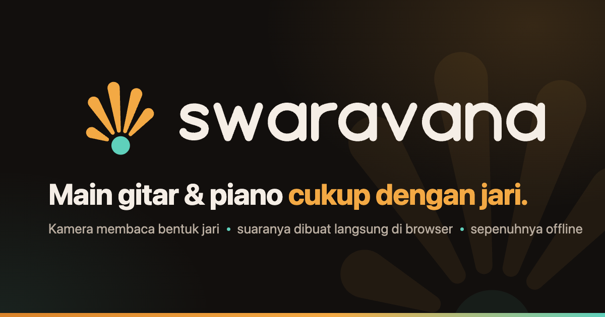

<p align="center">
  <picture>
    <source media="(prefers-color-scheme: dark)" srcset="public/brand/logo-lengkap-gelap.svg">
    
  </picture>
</p>

# Swaravana

Main gitar atau piano tanpa memegang alat musik. Kamu cukup membentuk jari di depan kamera laptop atau ponsel. Tangan kanan memilih akor, tangan kiri mengubah jenisnya (mayor, minor, 7, sus4, maj7, add9). Pola genjreng atau iringan piano lalu berjalan sendiri mengikuti tempo.

Semua proses terjadi di perangkatmu: pelacakan tangan, pengolahan gerakan, sampai suara gitar dan pianonya. Swaravana tidak butuh akun, API key, dependency npm, atau koneksi internet setelah halaman pernah dibuka sekali.

> Swaravana sebelumnya bernama **Akor Udara**. Beberapa nama di kode (misalnya kunci `akor.*` di `localStorage`) masih memakai nama lama.



## Fitur

- **Akor dari bentuk jari.** Kamera membaca 21 titik di tiap tangan lewat MediaPipe Hand Landmarker yang dijalankan langsung di browser. Ada empat cara memilih akor: bentuk jari, kombinasi jari, tinggi tangan, atau lima akor utama saja. Pilih yang paling cocok dengan kamera dan pencahayaanmu.
- **Gitar dan piano disintesis sendiri.** Suara gitar dibuat dengan Karplus-Strong, piano dengan sintesis aditif. Tidak ada file rekaman suara yang perlu diunduh.
- **Pola genjreng dan iringan.** Tersedia pop, balada, rock, funk, reggae, waltz 3/4, petik jari, arpeggio, dan pola iringan piano, dengan tempo yang bisa diatur. Pola juga bisa diketik sendiri dalam bentuk tab.
- **Kunci, capo, dan tuning.** Tersedia tuning standar, turun setengah, turun satu nada, dan drop D. Capo ikut dihitung, jadi bentuk G dengan capo 3 terdengar sebagai B♭.
- **Lagu bawaan dan sheet sendiri.** Lagu bawaannya lagu tradisional atau domain publik, isinya hanya akor tanpa lirik. Kamu juga bisa menempel sheet sendiri dalam format akor di atas lirik, ChordPro `[C]lirik`, atau bar `| C | G |`. Swaravana akan memilih kunci yang paling mudah dimainkan dan menunjukkan jari untuk tiap akor.
- **Diagram akor** gitar dan piano untuk setiap akor yang dimainkan.
- **Tanpa kamera pun bisa.** Ketuk pad di layar atau pakai keyboard (<kbd>A</kbd>–<kbd>G</kbd> dan seterusnya; daftar lengkapnya ada di panel *Pintasan keyboard* di aplikasi).
- **Bisa dipasang sebagai aplikasi (PWA).** Service worker menyimpan semua aset termasuk model MediaPipe (±19 MB), jadi aplikasi tetap terbuka saat offline.

## Privasi

- Gambar kamera diproses di browser dan **tidak dikirim ke mana pun**. Tidak ada server analitik, pelacak, atau CDN. Content Security Policy halaman membatasi koneksi hanya ke asal yang sama (`connect-src 'self'`).
- Kamera diminta tanpa mikrofon (`audio: false`).
- Pengaturan dan koleksi sheet disimpan di `localStorage` browser yang kamu pakai. Untuk memindahkannya ke perangkat lain, pakai tombol **Ekspor**/**Impor** yang menghasilkan file `.json`.
- Untuk keperluan penyetelan, nilai tekukan jari selama 30 detik terakhir disimpan di memori tab (`window.__akorRekam`). Data ini hilang saat tab ditutup dan tidak pernah dikirim.
- Swaravana tidak mengambil sheet dari situs mana pun. Sheet yang kamu tempel adalah tanggung jawabmu dan hanya untuk dipakai sendiri.

## Menjalankan di komputer sendiri

Yang dibutuhkan hanya Node.js 20 atau lebih baru. Tidak perlu `npm install`.

```bash
node server.mjs          # atau: npm start
# buka http://localhost:3209
```

Port bisa diganti dengan `PORT=8080 node server.mjs`. Kamera di browser hanya bisa dipakai di `localhost` atau lewat HTTPS.

File MediaPipe (`public/vendor/mediapipe/`) sudah ada di repositori. Kalau folder itu kosong, unduh sekali dengan:

```bash
npm run siapkan-model    # ±19 MB dari registry npm + penyimpanan model MediaPipe, dicek SHA-256
```

Setelah halaman dibuka sekali, server boleh dimatikan dan aplikasi tetap bisa dipakai.

### Dari zip rilis

Unduh `swaravana-vX.Y.Z.zip` dari halaman [Releases](https://github.com/kocwng/swaravana/releases), ekstrak, lalu jalankan `node server.mjs` di dalam foldernya. Isi zip sudah lengkap, termasuk model MediaPipe, jadi tidak perlu internet sama sekali. Kecocokan file bisa dicek dengan `.sha256` yang ikut dirilis:

```bash
shasum -a 256 -c swaravana-vX.Y.Z.zip.sha256
```

## Tes

```bash
node --test test/                 # atau: npm test
node scripts/cek-offline.mjs      # gagal bila ada dependency npm, URL eksternal, atau aset service worker yang hilang
```

## Deploy ke GitHub Pages

Versi daringnya ada di **https://swaravana.kusumalab.host**.

Workflow [`.github/workflows/pages.yml`](.github/workflows/pages.yml) menjalankan tes dan cek offline, lalu men-deploy isi `public/` (ditambah file lisensi di `/lisensi/`) setiap ada push ke branch `deploy`. Alurnya: kerjakan di branch terpisah, merge ke `main` (workflow CI menjalankan tes), lalu merge `main` ke `deploy`.

Syarat sekali atur: **Settings → Pages → Source: GitHub Actions**.

Aplikasi memakai path absolut (`/sw.js`, `/style.css`, `start_url: "/"`), jadi harus dibuka dari **root domain**, misalnya `swaravana.kusumalab.host`. Alamat bawaan `https://kocwng.github.io/swaravana/` berupa sub-path, jadi aplikasi tidak akan jalan di sana; alamat itu otomatis dialihkan ke domain kustom setelah domainnya terpasang. Langkah memasang domain kustom, DNS, dan pengamanannya ada di [docs/DEPLOY.md](docs/DEPLOY.md).

## Membuat rilis

1. Naikkan `version` di `package.json` dan tulis catatan rilis di `docs/CATATAN-RILIS-vX.Y.Z.md`.
2. Buat tag dan push:
   ```bash
   git tag -a v1.0.0 -m "Swaravana v1.0.0"
   git push origin v1.0.0
   ```
3. Workflow [`.github/workflows/rilis.yml`](.github/workflows/rilis.yml) menjalankan tes, membuat `swaravana-v1.0.0.zip` beserta `.sha256`, lalu menerbitkan GitHub Release. Kalau file catatan rilisnya tidak ada, catatan dibuat otomatis dari daftar commit.

Untuk membuat zip yang sama di komputer sendiri:

```bash
node scripts/buat-rilis.mjs v1.0.0 dist    # hasil: dist/swaravana-v1.0.0.zip
```

## Struktur

```
server.mjs                 server statis node:http (port 3209), tanpa dependency
public/                    seluruh aplikasi (HTML, CSS, JS, service worker, manifest)
public/js/                 teori musik, gestur, sintesis suara, pola, lagu, UI
public/vendor/mediapipe/   MediaPipe Tasks Vision + model tangan (pihak ketiga, Apache-2.0)
scripts/siapkan-model.mjs  unduh ulang file MediaPipe (dicek SHA-256)
scripts/cek-offline.mjs    pastikan aplikasi benar-benar offline
scripts/buat-rilis.mjs     buat zip rilis
test/                      tes node --test
docs/                      panduan deploy, catatan rilis, teks lisensi
```

## Lisensi

Kode Swaravana dirilis dengan [lisensi MIT](LICENSE), © 2026 kocwng. Lisensi ini hanya berlaku untuk kode Swaravana. Komponen pihak ketiga di `public/vendor/` tetap memakai lisensinya sendiri (lihat di bawah).

### Pihak ketiga

Swaravana menyertakan **MediaPipe Tasks Vision** dan model **Hand Landmarker** dari Google (The MediaPipe Authors), dengan lisensi [Apache License 2.0](docs/lisensi/Apache-2.0.txt). File-filenya tidak diubah. Rinciannya ada di [NOTICE](NOTICE) dan [THIRD_PARTY_NOTICES.md](THIRD_PARTY_NOTICES.md).
